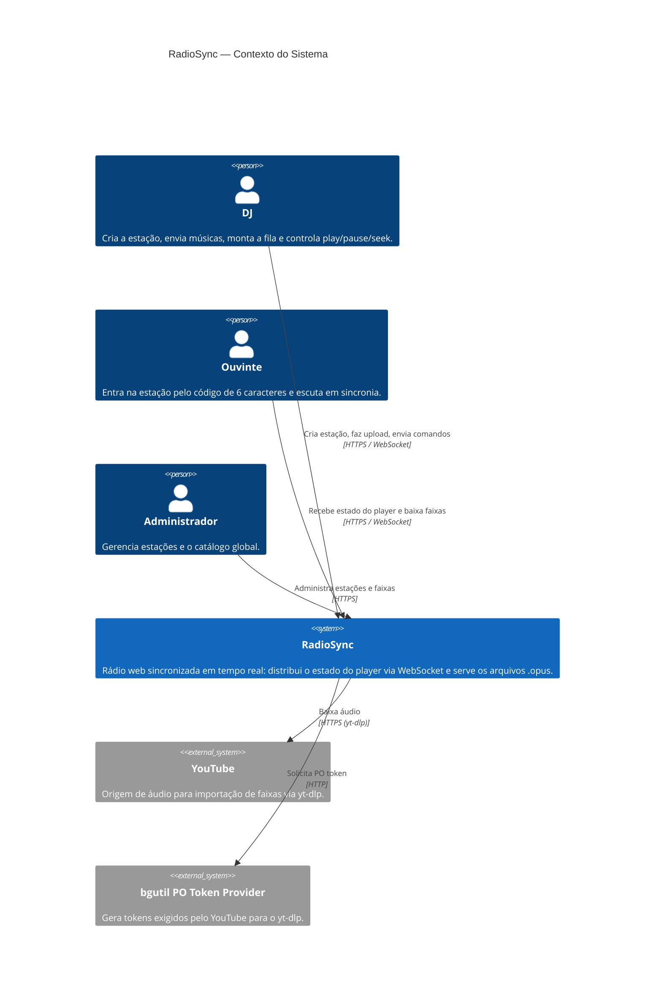

# C4 — Nível 1: Diagrama de Contexto

Quem usa o RadioSync e com quais sistemas externos ele conversa.

## Elementos

| Elemento | Tipo | Responsabilidade |
|---|---|---|
| DJ | Pessoa | Controla a estação. Autenticado por um JWT por estação (`djToken`). |
| Ouvinte | Pessoa | Somente leitura: recebe eventos e toca o áudio localmente. Pode sugerir músicas. |
| Administrador | Pessoa | Acessa `/api/v1/admin/*` (hoje sem autenticação — ver ADR-0005). |
| RadioSync | Sistema | O sistema deste projeto. |
| YouTube | Sistema externo | Fonte de áudio. Instável/bloqueante → protegido por Circuit Breaker (ADR-0002). |
| PO Token Provider | Sistema externo | Container auxiliar exigido pelo yt-dlp. |
