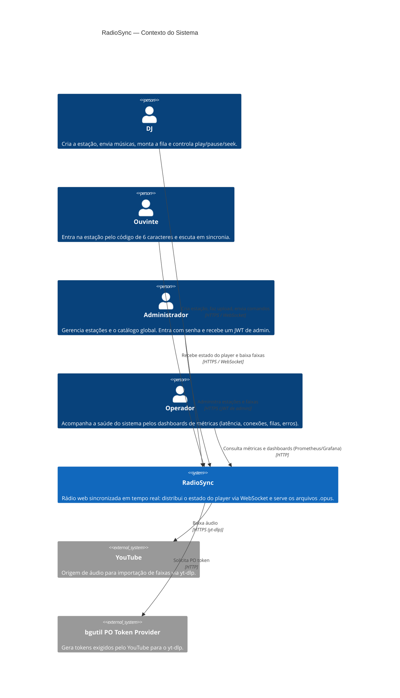

# C4 — Nível 1: Diagrama de Contexto

Quem usa o RadioSync e com quais sistemas externos ele conversa.

## Elementos

| Elemento | Tipo | Responsabilidade |
|---|---|---|
| DJ | Pessoa | Controla a estação. Autenticado por um JWT por estação (`djToken`). |
| Ouvinte | Pessoa | Somente leitura: recebe eventos e toca o áudio localmente. Pode sugerir músicas. |
| Administrador | Pessoa | Acessa `/api/v1/admin/*` com um JWT de admin obtido por senha (`ADMIN_PASSWORD`); sem senha configurada as rotas respondem `503` e sem token, `401` (ADR-0005). |
| Operador | Pessoa | Lê as métricas expostas em `/metrics` por cada serviço (latência por rota, conexões WebSocket, profundidade da fila, estado do circuit breaker), via Prometheus e Grafana. Os dashboards ficam em `infra/grafana/dashboards/`. |
| RadioSync | Sistema | O sistema deste projeto. |
| YouTube | Sistema externo | Fonte de áudio. Instável/bloqueante → protegido por Circuit Breaker (ADR-0002). |
| PO Token Provider | Sistema externo | Container auxiliar exigido pelo yt-dlp. |
