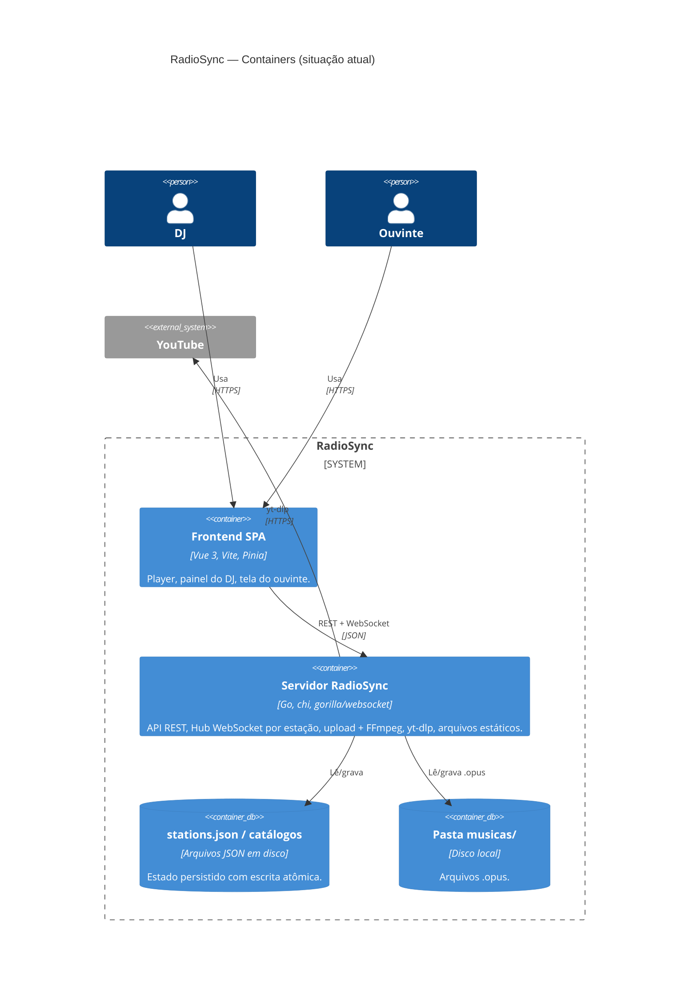
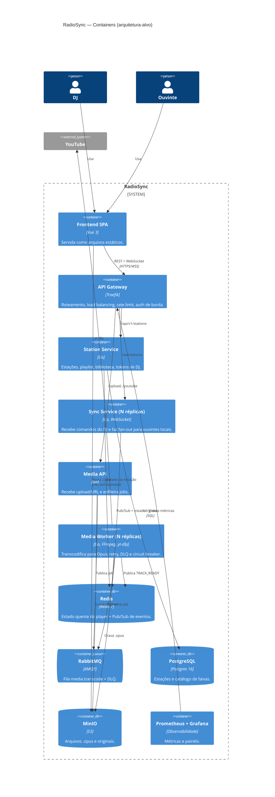

# C4 — Nível 2: Diagrama de Containers

Dois diagramas: como o sistema **é hoje** (monolito) e a **arquitetura-alvo** para a Entrega 3. A passagem de um para o outro segue o Strangler Fig (ADR-0003).

## 2.1 Situação atual (as-is)

**Limitações que motivam a evolução:** estado em memória e em arquivo local (não dá para ter duas réplicas); transcodificação bloqueia a requisição e disputa CPU com o WebSocket; rotas admin sem autenticação.

## 2.2 Arquitetura-alvo (to-be)

## Containers da arquitetura-alvo

| Container | Tecnologia | Responsabilidade | ADR |
|---|---|---|---|
| API Gateway | Traefik | Entrada única, LB, rate limit, auth de borda, roteamento do Strangler Fig | 0003, 0005 |
| Station Service | Go | CRUD de estações, playlist, biblioteca, emissão do `djToken` | 0006 |
| Sync Service | Go + WebSocket | Hub por estação; fan-out entre réplicas via Redis | 0001, 0004 |
| Media API | Go | Aceita upload/URL, responde `202 Accepted`, publica job | 0002 |
| Media Worker | Go + FFmpeg + yt-dlp | Transcodificação idempotente; retry, DLQ, circuit breaker | 0002 |
| Redis | Redis 7 | Estado quente e Pub/Sub | 0001 |
| RabbitMQ | RabbitMQ 3.13 | Fila de jobs + DLQ | 0002 |
| PostgreSQL | Postgres 16 | Dados duráveis | 0006 |
| MinIO | S3 compatível | Arquivos de áudio | 0006 |
| Prometheus / Grafana | — | Métricas (latência p95, filas, conexões) | — |

> Os diagramas usam a sintaxe C4 do Mermaid, renderizada pelo GitHub. Se precisarem de imagem para os slides, abram o arquivo no [Mermaid Live Editor](https://mermaid.live) e exportem em PNG/SVG.
