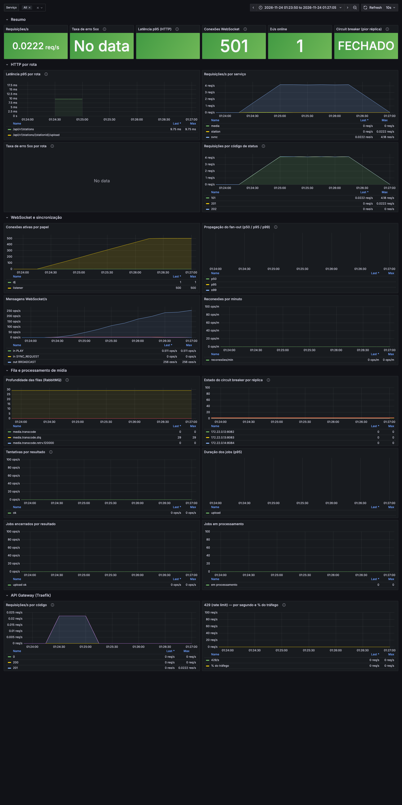
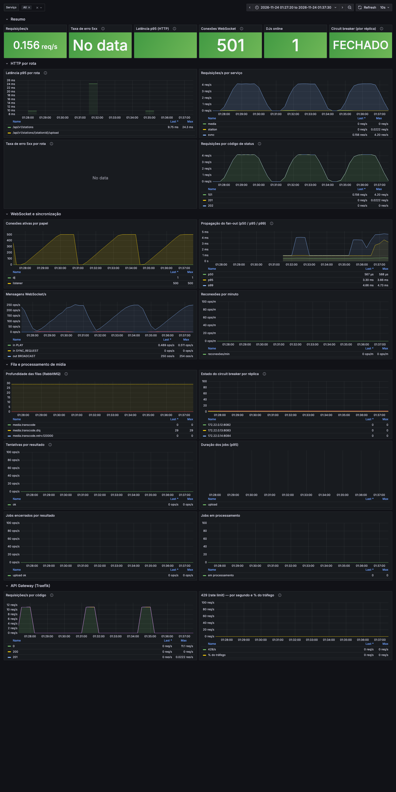
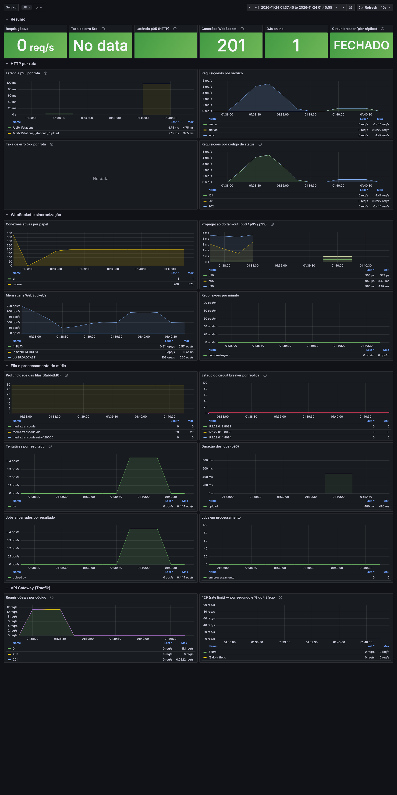

# Resultados dos testes

Relatório da frente de Observabilidade e Testes (issue #19). Compara o que foi
**medido** com as metas do [plano de testes](plano-de-testes.md). Todos os
números abaixo vêm de execuções reais; nenhum foi estimado.

Última atualização: 24/11/2026, sobre a `dev`.

## 0. Resumo contra as metas

| ID | Meta | Resultado | |
|---|---|---|---|
| Cobertura | ≥ 50% em `auth`, `model`, `ws` | auth 92,4% · model 95,7% · ws 86,0% | ✅ |
| LOAD-01 | 500 ouvintes, propagação p95 < 200 ms | **p95 = 12 ms** (máx. 20 ms), 0 erros | ✅ |
| LOAD-02 | 1, 2 e 4 réplicas, escala ~linear | p95 de 11, 10 e 14 ms; ouvintes distribuídos por igual; CPU ≈ 1–2% | ⚠️ ver 5.2 |
| LOAD-03 | 20 uploads + 200 ouvintes, degradação < 20% | p95 **6 → 7 ms** (+17%), 100% dos uploads aceitos | ✅ (com ressalva, 5.3) |
| LOAD-04 | gateway barra o excedente com 429 | 1490 de 1500 respostas 429 (99,3%), 0 erros 5xx | ✅ |
| LOAD-05 | desvio de sincronização p95 < 500 ms | **p95 = 1 ms** (máx. 6 ms), 100 clientes | ✅ |
| RES-01 | reconexão < 5 s | p95 = **504 ms**, 0 ouvintes perdidos | ✅ |
| RES-02 | worker morto, outro conclui | job `ready` 21 s após o `kill -9` | ✅ |
| RES-03 | 3 retries → DLQ; breaker abre | 7 jobs → DLQ (+7), 3 tentativas, breaker aberto | ✅ |
| RES-04 | Redis reiniciado, eventos voltam | 0 ouvintes perdidos, último evento há 1,9 s | ✅ |
| RES-05 | Postgres fora, erro claro | `503` em 0 s com mensagem; ouvintes seguem | ✅ |
| INT-01 a 05 | passam contra a infra | 11 de 11 passam; **6 usam fakes em memória** | ⚠️ ver 3 |
| CI | `dev` verde | CI e Security verdes | ✅ |

## 1. Ambiente e método

- **Máquina:** MacBook Air (Apple Silicon, `arm64`), Docker Desktop com 10 CPUs e 7,7 GiB. A stack do João (9 containers, ociosa) rodava ao lado.
- **Stack:** o Compose **completo** (14 containers: gateway Traefik, `sync`, `station`, `media`, `media-worker`, monólito, Redis, RabbitMQ, Postgres, MinIO, Prometheus, Grafana, Jaeger, bgutil), como projeto isolado `iso` (`tests/stack-isolada/`). O gateway aplica as **regras reais** do Compose (rotas e limites de taxa vêm dos rótulos do `docker-compose.yml`).
- **k6 v2.4.0** em container **dentro da mesma rede**: o relógio do k6 é o dos servidores, então a latência de propagação (`Date.now() - state.startedAt`) não carrega erro de relógio entre máquinas.
- **Tracing ligado** (100% de amostragem) em todos os serviços durante os testes, então os números já incluem esse custo.
- **Limite:** o k6 e a stack dividem a mesma máquina; em cargas altas parte da latência pode ser disputa de CPU.

## 2. Testes unitários e cobertura

`go test -cover ./...`:

| Pacote | Cobertura | | Pacote | Cobertura |
|---|---|---|---|---|
| `security` | 100,0% | | `queue` | 41,3% |
| `model` | **95,7%** | | `stationservice` | 45,9% |
| `auth` | **92,4%** | | `storage` | 41,0% |
| `mediaservice` | 90,6% | | `jobs` | 43,7% |
| `breaker` | 90,0% | | `handler` | 29,4% |
| `mediaworker` | 86,7% | | `syncservice` | 49,9% |
| `ws` | **86,0%** | | `importer` | 65,8% |
| `tracing` | 76,8% | | `metrics` | 73,0% |
| `media` | 71,9% | | | |

Os `cmd/*` (pontos de entrada) não têm teste. Antes do trabalho desta frente,
`model` estava em 8,6% e `ws` em 43,0%. Um bug real foi achado ao testar o `ws`:
o `Hub.Run` removia clientes do mapa segurando só `RLock` (corrida de dados).

## 3. Integração e resiliência em Go

`tests/integration/run.sh` roda os 11 testes contra Postgres, Redis e RabbitMQ
reais. **Todos passam.** O que cada um usa de verdade:

| Teste | Infra real? |
|---|---|
| INT-02, RES-02, RES-03 | **RabbitMQ real** |
| INT-01, INT-04, INT-05, RES-01, RES-04, RES-05 | **Fakes em memória** (`MemoryBroker`, `MemoryRepository`) |
| INT-03 | httptest, sem infra |

O plano prometia infra real em todos. Os seis em memória validam a **lógica**,
mas não a sobrevivência a uma falha de infraestrutura de verdade (o `RES-04`
"reinicia o Redis" só refazendo a assinatura num broker em memória). **Essa
lacuna é coberta pela seção 4**, que derruba containers reais.

## 4. Resiliência com falha real

Scripts de `tests/resilience/` contra o **Compose completo**. Cada um injeta a
falha com `docker stop`/`kill`/`restart` e confere a recuperação.

| Cenário | Falha | Resultado | Meta |
|---|---|---|---|
| **RES-01** | `docker stop` de 1 das 2 réplicas do sync (30 ouvintes) | 15 de 30 ouvintes caíram; **todos reconectaram**; reconexão **p95 = 504 ms** | p95 < 5 s ✅ |
| **RES-02** | `docker kill` (SIGKILL) do worker no meio de uma conversão (áudio de 20 min) | job estava `processing`; um container **novo** concluiu: `ready` **21 s** depois do kill, sem gastar tentativa, faixa gerada. Repetido 2 vezes, mesmo tempo | outro worker conclui ✅ |
| **RES-03** | YouTube inacessível (domínios → `127.0.0.1` no worker), retries de 2/4/6 s | 7 jobs terminaram `failed`; DLQ **+7**; o job tentou 3 vezes; **breaker aberto** (estado 2) | 3 retries → DLQ; breaker abre ✅ |
| **RES-04** | `docker restart` do Redis com DJ tocando | 0 quedas de conexão; último evento há **1,9 s** ao fim; o Redis voltou com 59 chaves (AOF) | < 5 s sem evento ✅ |
| **RES-05** | `docker stop` do Postgres | `POST /stations` → **503 em 0 s** com mensagem clara ("PostgreSQL temporariamente indisponível"); ouvintes seguiram (último evento há 1,95 s) | erro claro, ouvintes seguem ✅ |

Limites: o RES-03 usa retries encurtados (2/4/6 s, no lugar de 5 s/30 s/2 min) e
um bloqueio de rede simulado por `extra_hosts`. Cada cenário foi executado uma
ou duas vezes, sem repetições para medir variância. O RES-01 dá 504 ms aqui,
contra 2,39 s numa mini-stack anterior: com o gateway do Compose o Traefik
retira a réplica parada na hora.

## 5. Carga



### 5.1 LOAD-01: 500 ouvintes numa estação

Rampa de 120 s até 500 ouvintes e 60 s no pico; um DJ envia `PLAY` a cada 2 s.

| Métrica | Valor |
|---|---|
| Propagação do `PLAY` (p95) | **12 ms** (média 7 ms, mediana 7 ms, máx. 20 ms) |
| `STATE_UPDATE` recebidos | 31.235 |
| Erros de WebSocket | 0 |
| Conexão WebSocket (p95) | 3,2 ms (máx. 7 ms) |

Meta: p95 < 200 ms. **Atendida com folga (16 vezes menor).**

### 5.2 LOAD-02: 1, 2 e 4 réplicas do sync



500 ouvintes em cada fase.

| Réplicas | p95 da propagação | CPU do sync (soma, média / pico) | Ouvintes por réplica | Fan-out entre réplicas (p50 / p95 / p99) |
|---|---|---|---|---|
| 1 | 11 ms | 1,2% / 3,0% | 500 | n/a (não há outra réplica) |
| 2 | 10 ms | 1,6% / 3,4% | 250 · 250 | 0,51 / 0,96 / 1,68 ms |
| 4 | 14 ms | 1,9% / 4,2% | 126 · 125 · 125 · 124 | 0,53 / 1,89 / 4,38 ms |

**O que os números dizem, e o que não dizem.** A distribuição é perfeitamente
uniforme e o fan-out entre réplicas custa 1 a 2 ms no p95. Mas **a meta "escala
~linear" não pôde ser demonstrada**: com 500 ouvintes uma única réplica usa só
~1% de CPU, longe da saturação, então acrescentar réplicas não muda a latência
(as diferenças de 10 a 14 ms estão no nível do ruído). Para mostrar escala
seria preciso uma carga que sature uma réplica, ou limitar a CPU do container.
O que se pode afirmar: replicar o sync **não piora** a latência e divide a
carga igualmente.

### 5.3 LOAD-03: 20 uploads simultâneos com 200 ouvintes



| Variante | Uploads aceitos | Resposta do upload (p95) | Propagação antes → durante (p95) |
|---|---|---|---|
| **Direto na Media API** (mede o efeito da fila) | **20 de 20 (100%)** | 74 ms (meta < 500 ms) | **6 → 7 ms (+17%)** |
| **Pelo gateway** | 2 de 20 (10%) | 44 ms | 7 → 6 ms |

- Pela fila, o upload responde `202` rápido e os ouvintes não sentem: +1 ms no p95 (e a **média** caiu, de 4,8 para 4,4 ms). A meta era degradação < 20%; o resultado, 17%, cumpre, **mas em resolução de 1 ms** (6 vs 7), então a diferença é indistinguível do ruído.
- **Pelo gateway, 18 de 20 uploads são barrados.** É o limite de taxa do ADR-0005 (`media-ratelimit`: 6 por minuto, rajada de 3, por IP) funcionando. Um teste de 20 uploads de um só IP **não** é viável pelo gateway; por isso a variante direta.
- O arquivo é pequeno (368 KB, ~0,5 s de conversão), então a carga sobre o worker é leve. Um teste mais exigente usaria arquivos longos.

### 5.4 LOAD-04: rajada acima do limite do gateway

50 req/s por 30 s no `POST /stations` (1500 requisições), contra as **regras
reais** do Compose (`create-station-ratelimit`: 10 por minuto, rajada de 5).

| Métrica | Valor |
|---|---|
| Estações criadas (201) | 10 |
| Bloqueadas (429) | **1490 (99,3%)** |
| Erros 5xx | **0** |

Meta: o gateway barra o excedente sem derrubar o serviço. **Atendida.**

### 5.5 LOAD-05: desvio de sincronização

100 clientes pedem `SYNC_REQUEST` a cada 2 s por 90 s (4700 respostas). Desvio =
`|posição do servidor + RTT/2 − posição esperada pelo estado do DJ|`.

| Métrica | Valor |
|---|---|
| Desvio (p95) | **1 ms** (mediana 0,5 ms, máx. 6 ms) |
| RTT (p95) | 5 ms (máx. 13 ms) |

Meta: p95 < 500 ms. **Atendida.** A diferença entre dois clientes quaisquer é no
máximo o dobro disso. Medido numa máquina só, sem rede real entre cliente e servidor.

## 6. Tracing (OpenTelemetry + Jaeger, ADR-0009)

Validado na stack completa com tráfego real:

- **Upload:** um trace só, **7 spans em 3 serviços** (gateway → Media API → `queue.publish` → worker `media.job` → `media.process` → `redis.publish`), com a relação pai/filho correta através da fila.
- **Comando do DJ com 2 réplicas:** em **14 de 14** traces, `ws.command PLAY` (réplica A) → `redis.publish` → `redis.fanout` (réplica B).

## 7. CI

Na `dev` os workflows **CI** e **Security** passam. O Security estava vermelho
por **GO-2026-6278** em `gorilla/websocket` (PRNG fraco na máscara do WebSocket)
e, depois da atualização, por dois CVEs HIGH em `golang.org/x/net` apontados
pelo Trivy; ambos corrigidos (PRs #32). O `gitleaks` também barrou um PR que
continha, por engano, um JWT de teste num arquivo de resultado do k6; a branch
foi reescrita sem o arquivo e `tests/*/results/` entrou no `.gitignore`.

## 8. O que os testes encontraram

Testar de verdade expôs problemas que a leitura do código não mostrava:

| Achado | Como apareceu | Correção |
|---|---|---|
| Handshake de WebSocket contado como `200`, e só **ao fechar** a conexão | pico de tráfego no fim de um teste na captura do Grafana | PR #40: conta o `101` no `Hijack`; o teste novo falha com o código antigo |
| Prometheus **misturava as réplicas do sync** numa série só (alvo fixo `sync:8082`); mostrava 250 e 124 conexões em vez de 500 | LOAD-02 com 2 e 4 réplicas | `dns_sd_configs`, como o `media` |
| Prometheus **não raspava o `station`** | a stack isolada listava 5 jobs | job `station` adicionado |
| 6 dos 11 testes INT/RES **usam fakes em memória** | rodar o harness contra infra real | resiliência real em `tests/resilience/` |
| `Hub.Run` escrevia no mapa com `RLock` | teste do `ws` | `Lock` |
| Limite do gateway barra 18 de 20 uploads simultâneos | LOAD-03 pelo gateway | documentado; variante direta |
| O **Mac entrou em repouso** durante um teste e o invalidou (32 min, 43% de erros) | LOAD-01 com duração absurda | refeito sob `caffeinate`; resultado descartado |

## 9. Limites e o que ainda falta

- **Uma máquina, uma execução** de cada cenário (exceto RES-02, duas). Sem repetições, não há variância nem intervalo de confiança.
- **LOAD-02 não demonstra escala**: a carga não satura uma réplica (5.2).
- **Tracing a 100%** e k6 na mesma máquina podem inflar um pouco as latências.
- O **ForwardAuth do Traefik** (INT-03 na camada do gateway) não tem teste automatizado: só vimos `503` por não haver `ADMIN_PASSWORD` na stack de teste.
- **Resiliência de deployment** (rolling update, ADR-0007) não foi testada.

## 10. Como reproduzir

```bash
# unitários e cobertura
cd backend && go test -race -cover ./...

# integração e RES em Go, contra infra real descartável
tests/integration/run.sh

# Compose completo ao lado de outra stack, sem conflito
cp .env.example .env && tests/stack-isolada/up.sh
export COMPOSE_PROJECT_NAME=iso COMPOSE_FILE=docker-compose.yml:tests/stack-isolada/override.yml
export IMAGE_TAG=iso COMPOSE_NETWORK=iso_default GATEWAY_LOCAL=http://localhost:18080

caffeinate -dimsu tests/load/run.sh load-01        # LOAD-01 a LOAD-05; veja tests/load/README.md
tests/load/load-02-replicas.sh
tests/resilience/res-01-replica-sync.sh            # RES-01 a RES-05
tests/load/captura-grafana.sh docs/img/x.png "2026-11-24 01:23:50" "2026-11-24 01:27:05"
```

No macOS, rode as cargas longas sob `caffeinate`: o repouso do sistema congela os
timers do k6 e invalida o teste.
